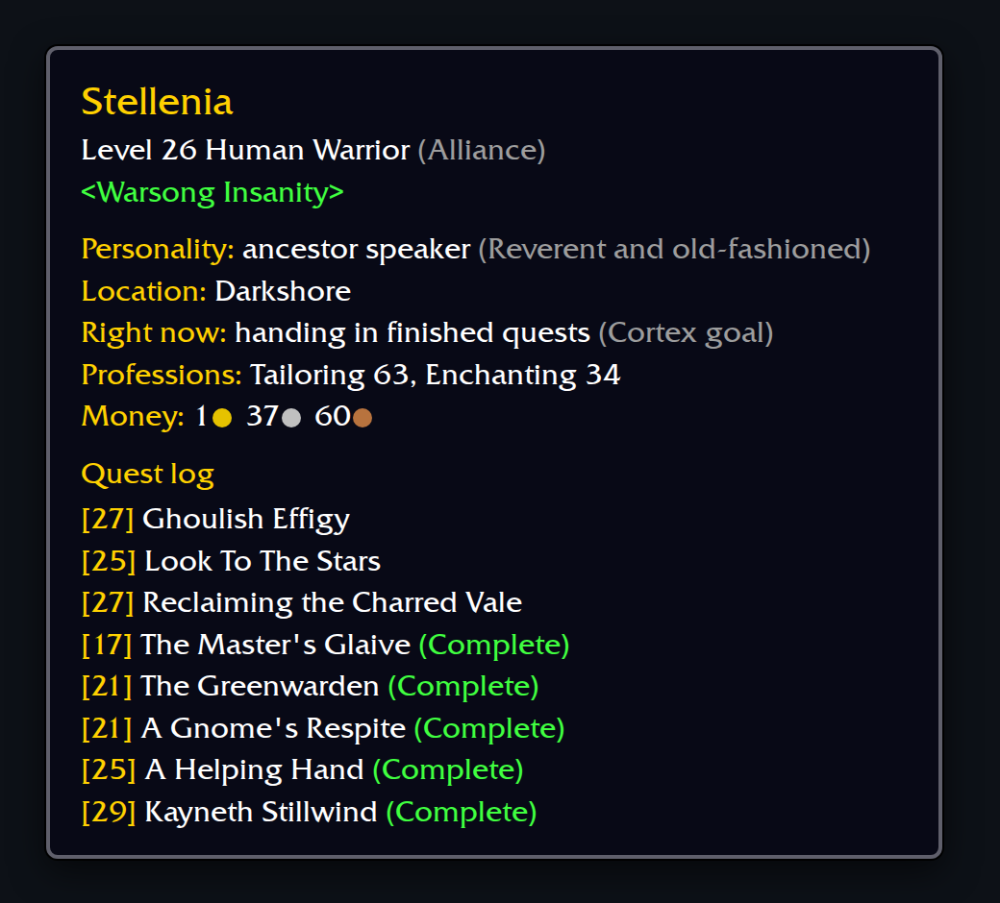
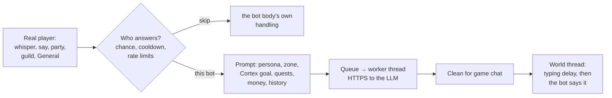

# mod-cortex-chat

**Bots that answer real players in character, through an LLM**

Whisper a bot, talk near it, ask in General: it answers as itself, from what it is and what it is doing right now.

A live bot at 02:27 UTC on 2026-10-21, drawn from its database rows: what the prompt tells the model about the bot
before it answers.

## What it does

| | |
|---|---|
| **Real players only** | Only chat from real players gets a reply. Bots never chat to each other through the model. |
| **In character** | The prompt carries the bot's name, race, class, level, guild, persona, zone, what Cortex says it is doing, its quest log, professions, money and group. |
| **Every channel** | Whispers always get an answer, within the rate limits. /say within 25 yd, party and raid, guild and General reply by chance (see the config). |
| **Feels typed** | A reading delay, then a typing delay per character. Long answers are cut to one chat line and cleaned of markdown. |
| **Remembers the talk** | The last 8 lines per player and bot, for 20 minutes. |
| **Stays cheap** | Guards of 20 requests a minute and 3,000 a day. A bounded queue, worker threads, and replies dropped when they come too late. |

## How it works

- **The bot body stays out of it.** mod-cortex's chat hook (`CortexChatHook`) keeps the body from running a real
  player's whisper as a command, refusing it, or adding its canned reply when this module answers. Real commands
  from someone allowed to give them still reach the body.
- **Off the map threads.** HTTP calls run on worker threads (cpp-httplib over OpenSSL, nlohmann/json). The reply is
  said on the world thread, so a slow provider never stalls the game.
- **Providers.** The Anthropic Messages API is the default (`claude-haiku-5-5`). Any OpenAI-compatible Chat
  Completions endpoint (OpenAI, OpenRouter, vLLM, LM Studio) and Ollama also work.

## Install

1. Build AzerothCore 3.3.5a with [mod-cortex](https://github.com/italicninja/mod-cortex), following its install
   steps (see [Requirements](#requirements)).
2. Clone into `azerothcore-wotlk/modules/mod-cortex-chat` and build statically (`-DMODULES=static`); it includes
   mod-cortex's headers directly.
   `mod-cortex-chat.cmake` links OpenSSL, which the build needs installed.
3. Copy `conf/mod_cortex_chat.conf.dist` to `etc/modules/mod_cortex_chat.conf` and set `CortexChat.Enable = 1`.
4. Put the API key in the environment as `AC_CORTEX_CHAT_API_KEY` (on Kubernetes, from a Secret). It overrides
   `CortexChat.ApiKey`, which stays empty in any committed file.
5. Check the startup log for `CortexChat: on, anthropic claude-haiku-5-5 at …`.

## Requirements

| Needs | For |
|---|---|
| mod-cortex `CortexChatHook` | Keeping the bot body from handling the chat this module answers |
| mod-cortex bot personas | The bot's persona and the `cortex_personas` table in `acore_cortex` (descriptions are read at startup) |
| mod-cortex `BotTelemetry` | `chat` telemetry rows |
| mod-cortex `Cortex::Describe` | What the bot is doing |
| OpenSSL | HTTPS to the provider |

`deps/` vendors cpp-httplib v0.62.0 and nlohmann/json v3.12.0, both MIT and unmodified (see `deps/README.md`).

## Configuration

`etc/modules/mod_cortex_chat.conf`. Each key is documented in the `.dist` file.

| Key | Default | What |
|---|---|---|
| `CortexChat.Enable` | `0` | Chat through the LLM |
| `CortexChat.Provider` / `Url` / `Model` | `anthropic` / Messages API / `claude-haiku-5-5` | `anthropic`, `openai` or `ollama` |
| `CortexChat.ApiKey` | `""` | Leave empty; set env `AC_CORTEX_CHAT_API_KEY` |
| `CortexChat.MaxTokens` / `MaxReplyLength` | `300` / `250` | Model output and chat line length |
| `CortexChat.MaxRequestsPerMinute` / `PerDay` | `20` / `3000` | Cost guards |
| `CortexChat.Workers` / `QueueSize` / `TimeoutMs` / `Retries` | `2` / `32` / `20000` / `1` | Request handling |
| `CortexChat.ReadDelayMs` / `TypingMsPerChar` / `MaxTypingMs` | `1500` / `50` / `10000` | How human it feels |
| `CortexChat.Whisper.Enable` | `1` | Whispers, always answered |
| `CortexChat.Say.*` | on, 25 yd, 50% | /say near bots |
| `CortexChat.Party.*` / `Guild.*` | on, 70% / 40% | Group and guild chat |
| `CortexChat.Channel.*` | on, channel 1, 70% questions / 10% other | General |
| `CortexChat.History.Lines` / `Minutes` | `8` / `20` | Conversation memory |
| `CortexChat.ExtraInstructions` / `LogPrompts` | `""` / `0` | Extra system-prompt text; log prompts for debugging |

Logger `module.cortexchat`. Every 10 minutes it writes a `CortexChat:` line with requests, lines said, skips,
failures, latency and tokens.

## Commands

None. Talk to a bot.

## Status

Live on a private realm since 2026-10-19 with Anthropic's `claude-haiku-5-5`. It was developed in the wowproject
repo until 2026-10-21.

## License

GPL-2.0, like AzerothCore. See `LICENSE`. The vendored libraries in `deps/` are MIT.
